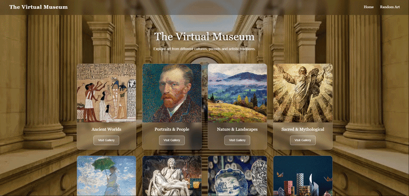

# Art Museum Exhibition

**A Python Flask web application that displays a simple art museum with different artistic categories.**



## Project Structure
- `api.py` — Retrieves data from [artsearch.io](https://artsearch.io/) API.  
- `main.py` — Runs the flask website and manages the routes.

## Features
- Uses customized queries to get data from [artsearch.io](https://artsearch.io/) API.
- Has 8 different art galleries: 'Ancient Worlds', 'Portraits & People', 'Nature & Landscapes', 'Sacred & Mythological', 'Impressionism & Beyond', 'Sculpture', 'Art Beyond Paintings', 'Art Around the World' 
- The Random Artwork page shows a random artwork with descriptions whenever the user press `Discover Another Artwork` button.

## Technologies
- Python 3.13
- Flask
- requests
- `os` and `math` modules

## Concepts Practiced
- Interacting with APIs and sending requests (+ parameters and headers)
- Representing JSON data structure.
- Web developing with Flask.
- Error handling with Flask and displaying a custom error page.
- Setting environment variables in different operating systems.

## Credits
- The static visual design (HTML/CSS) was generated with AI and adapted for this project.
- All Python/Flask code and Jinja templating are my own work.

## Configuration
Sign up in [artsearch.io](https://artsearch.io/console/#Dashboard) to get an api-key. Free plan has a limitation of 50 requests per day.
Then set the key as environment variable before running the app:
```bash
# Windows (Powershell)
$env:API_KEY = "your-api-key"
```
```bash
# Windows (cmd)
set API_KEY=your-api-key
```
```bash
# macOS / Linux
export API_KEY="your-api-key"
```

## How to Run
Install the required packages:
```bash
pip install -r requirements.txt
```
Set the `API_KEY` environment variable (see [Configuration](#configuration))
Then run the program:
```bash
python main.py
```